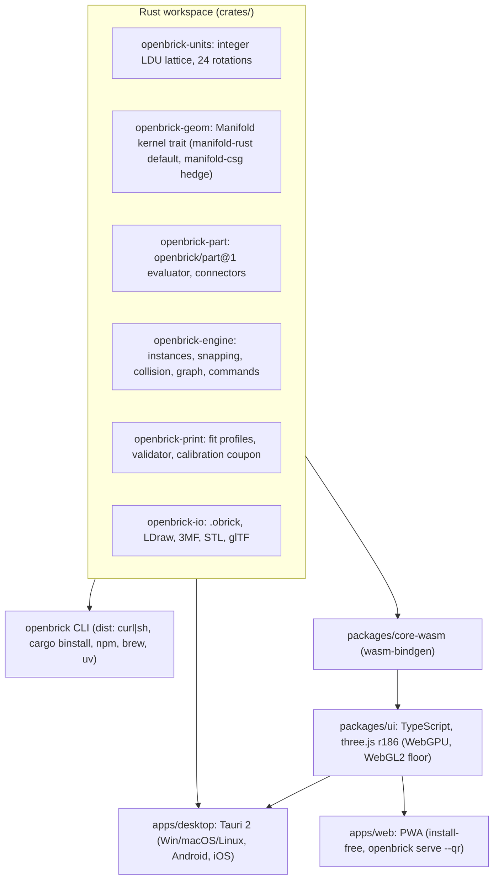

# Executive summary

**Purpose.** This page is the decision. It states what OpenBrick3D is, who it serves, the stack we chose, the first shippable milestone, the numbers every other document reuses, and the five risks and five questions that matter most. Everything else in this folder is the supporting detail.

## What we are building

OpenBrick3D is an open-source (MIT) tool for brick-compatible building, with three pillars that share one core:

1. **Part designer.** A parametric, print-first designer for parts that do not exist in any catalogue: logo tiles, nameplates, keychains, mosaics, adapters and alt-system bridges. This is the merchandise engine.
2. **Assembler.** A snap-together builder for play and planning, handling 10k to 100k bricks, saving open text formats and round-tripping to the LDraw ecosystem.
3. **Print pipeline.** A calibration-driven path from part to validated 3MF or STL, with per-printer fit profiles, so what comes off the printer actually clutches.

We decided the print pipeline exists to make **new** parts, not to clone standard bricks. Brickset's 2026 consumer-printer test found printed standard bricks have clutch "nowhere near" moulded parts and are "not worth the time and effort" (ecosystem research, see [13, sources](13-risks-and-open-questions.md#4-sources)). The value is in parts nobody moulds.

## Who it is for

Merch designers and small print farms (revenue), hobbyist builders (community), parents and kids playing (reach), and open-source contributors (longevity). Desktop (Windows, macOS, Linux) is first-class; mobile (Android, then iOS) and a PWA come second; everything is installable from a terminal.

## The chosen direction

A **Rust core** compiled natively (CLI, desktop commands) and to WASM (web, PWA, mobile webviews), with a **TypeScript + three.js** viewport inside a **Tauri 2** shell, the same bundle served as a **PWA**, and a **`dist`-built CLI**. Geometry runs on the **Manifold** kernel (guaranteed-manifold booleans, used by Blender 4.5 and OpenSCAD nightlies).

Why this and not the alternatives (full comparison in [03](03-tech-stack-decisions.md)):

- **Web-first TypeScript only** loses the CLI and the native mobile kernel path, and would need a second geometry implementation later.
- **Game engine first (Bevy or Godot)** gives the best play feel but Godot's web export is WebGL2-only with Safari problems, Bevy breaks every four months and has no editor tooling, and both make the part designer harder for web contributors.
- **CAD-first Python (OCCT)** gives true B-rep and STEP but OCCT cannot reach mobile or browsers sanely (48.9 MB WASM, LGPL relinking on iOS). We keep OCCT as an optional out-of-process STEP service in v2.

## The MVP

**End of M2, week 17 with three engineers (about week 22 with two):** on desktop (and from the CLI) a user prints the calibration coupon, records which stud and socket sizes fit, designs a 2x4 logo tile from an SVG, sees validation pass, exports a 3MF, prints it, and it clutches onto standard bricks. That one journey proves all three pillars' plumbing. The assembler follows in M3a and M3b (week 27), PWA, Android and merch batches in M4 (week 35), iOS in M5 (week 45), 1.0 in M6 (week 56). See [11](11-roadmap.md).

## Canonical numbers (short form)

| Quantity | Nominal | Print target (FDM 0.4 mm) |
|----------|---------|---------------------------|
| Module (stud pitch) | 8.0 mm = 20 LDU (measured 7.986 mm) | 7.98 to 8.02 mm |
| Brick / plate height | 9.6 / 3.2 mm = 24 / 8 LDU | 3.18 to 3.22 mm per plate |
| Stud diameter | 4.8 mm = 12 LDU (measured 4.87 to 4.90) | printed 4.75 to 4.85 mm (coupon sweeps 4.60 to 4.95) |
| Anti-stud (tube bore) | 4.8 mm | printed 4.90 to 5.00 mm |
| Tube outer diameter and ribs (the pocket that grips a stud) | 6.514 mm (8 x sqrt 2 minus 4.8); ribs 0.3 mm | calibrated by the coupon pocket row (OD 6.40 to 6.65, ribs 0.2 to 0.5); tube wall kept at least 0.7 mm |
| Side wall / roof | 1.2 mm + 0.3 mm ribs / 1.0 mm | 0.8 or 1.2 mm / at least 1.0 mm |
| Part undersize | 0.1 mm per side (n x 8 minus 0.2) | unchanged |
| Minimum emboss stroke | n/a | 0.8 mm; relief 0.4 to 1.5 mm (0.4 to 1.0 recommended for logos) |
| Clutch reference | 2.5 to 3 N to separate two 2x4 bricks | pull-test target |

Full tables with sources are in [04](04-brick-geometry-spec.md) and [05](05-3d-printing-pipeline.md).

## Performance budgets

10k bricks at 60 fps on every tier; 100k at 60 fps on an integrated-GPU laptop and 30 fps on a mid-range phone, both with LOD (average under 300 triangles per instance after LOD). Snap query under 2 ms at 100k instances. Logo-tile evaluation under 500 ms on desktop, under 2 s on a phone.

## Top five risks

1. **manifold-rust is young** (0.19.1, 33 stars). Mitigation: kernel trait; manifold-csg hedge for CLI and desktop; manifold-3d (WASM) hedge for web and mobile; conformance corpus in CI from M0; a 2-week contingency on M2.
2. **Mobile webviews render on the weakest path** (no WebGPU in WebKitGTK, uneven Android WebView). Mitigation: WebGL2 is the floor; device benchmark harness in week 1; native wgpu renderer on the watch list.
3. **Name collision.** `cwesson/openBrick` on GitHub and the German retail brand "Open Bricks" (Open Brick Source GmbH & Co. KG). Mitigation: project name is **OpenBrick3D** everywhere; merch brand is a separate coined name after a paid clearance search.
4. **Printed clutch depends on calibration people may skip.** Mitigation: first-run coupon wizard; batch export refuses to run without a calibrated profile for fit-critical features.
5. **Scope for a small team.** Mitigation: MVP is one journey and M1 and M2 contain only what that journey uses; assembler, mobile and scripting are sequenced behind it, each with a demo criterion and a definition of done.

## Top five open questions

1. Can connectivity for enough of the ~17k LDraw parts be derived from primitive references alone? Spike in M0.
2. Do we default to "fits genuine bricks" (needs calibration) or "fits itself" (prints anywhere)? Decided by the coupon data from M1 dog-fooding.
3. Does Android System WebView expose WebGPU by default on Android 12+ devices? Device test in M0.
4. Is STEP export needed before 1.0? Default no; OCCT service in v2.
5. Will Roland Melkert license LDCad shadow-library snap data, or do we author clean-room from day one? Default clean-room, ask anyway.

## Immediate actions (this week)

- Register the free handles: GitHub org `openbrick3d`, npm `openbrick3d` and the `@openbrick` scope, crates.io `openbrick`, PyPI `openbrick3d`, domains `openbrick3d.com`, `openbrick3d.org`, `openbrick.dev`.
- Enrol in the Apple Developer Program ($99/year) in the company's name; apply to SignPath Foundation; start the Google Play organisation account (D-U-N-S takes up to 28 days).
- Order a digital micrometer and 20 to 30 samples each of the reference parts for the measurement program in [04](04-brick-geometry-spec.md).
