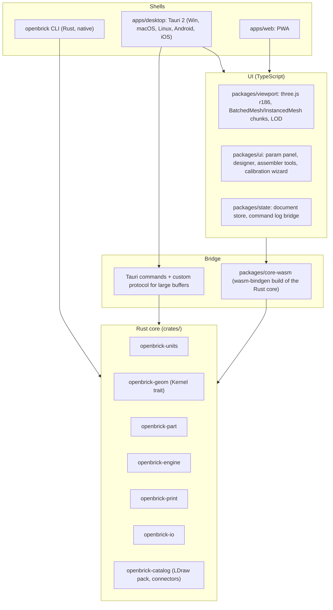

# Architecture

**Purpose.** The layered architecture, module boundaries and public APIs, the WASM boundary and threading model, two end-to-end data flows, the plugin model, error handling, and performance budgets. Stack choices are justified in [03](03-tech-stack-decisions.md); this document assumes them.

## Contents

1. Layers
2. Crates and packages
3. The WASM boundary and threading
4. Data flow: design a logo tile, validate, export 3MF
5. Data flow: assemble, save, share, print
6. Plugin and extension model
7. Errors, logging, telemetry stance
8. Performance budgets

## 1. Layers



Rules that keep the layers honest:

- The core has **no three.js, no DOM, no Tauri types**. It exposes plain data (typed arrays, JSON) and is tested headless.
- The UI never computes geometry or connectivity itself; it asks the core (via WASM in the browser, via Tauri commands on desktop when native speed is wanted).
- Shells own only platform concerns: windows, file dialogs, share sheets, updater, store compliance.

## 2. Crates and packages

| Unit | Responsibility | Public surface (sketch) |
|------|----------------|-------------------------|
| `openbrick-units` | Integer LDU types, the 24-element cube rotation group with a 24x24 composition table, mm conversions, the Dimensional Standard v1 constants loaded from `standards/dimensions-v1.json`. | `Ldu(i32)`, `Rot24(u8)`, `LatticePose { pos: [Ldu;3], rot: Rot24 }`, `FreePose(f64 TRS)`, `Dim::STUD_PITCH_MM`, `to_mm(Ldu) -> f64`. |
| `openbrick-geom` | Kernel trait over Manifold; 2D cross-sections (Clipper2 offsets through Manifold), extrude, revolve, booleans, Minkowski, level-set; tessellation defaults per export profile. | `trait Kernel { fn extrude(...); fn union(...); fn difference(...); fn offset2d(...); fn to_mesh(...) }`, `ManifoldRust`, `ManifoldFfi` (feature flag). |
| `openbrick-part` | Parser and evaluator for `openbrick/part@1`: typed params, expression language for `visibleWhen`/`if`, feature ops (body.*, stud.field, tube.field, technic.hole, axle, bar, clip, hinge.finger, relief.svg, relief.text, loop.keyring, mosaic), connector derivation, content hashing. | `PartDoc::parse(&str)`, `PartDoc::evaluate(&Params, &FitProfile, &dyn Kernel) -> Built { mesh_by_color_role, connectors, warnings }`, `derive_snap(&Built) -> Vec<Connector>`. |
| `openbrick-print` | Fit profiles, process profiles (fdm-0.4, fdm-0.2, resin, sls), validator rules with thresholds, calibration coupon generator and profile writer, print-plate nesting, serial marking. | `FitProfile`, `ProcessProfile`, `validate(&Built, &ProcessProfile) -> Report { blockers, warnings }`, `coupon(&ProcessProfile) -> PartDoc`, `nest(&[Built], &Bed) -> Vec<Plate>`. |
| `openbrick-engine` | Instance tables (SoA), part catalog handle, lattice spatial hash, connector hash, occupancy-mask collision, connection graph with union-find and articulation points, command log with inverse commands, step/submodel model, instruction step generation. | `Document`, `Command`, `apply(&mut Document, Command) -> Inverse`, `snap_query(&Document, part, cursor_pose) -> Vec<SnapCandidate>`, `collides(...)`, `structure_report(...)`. |
| `openbrick-catalog` | Packed LDraw subset (downloaded, cached, checksummed), own type-1 line parser, primitive scanning to derive connectors, LOD baking, occupancy masks, colour table from LDConfig.ldr, Rebrickable ID crosswalk loader. | `Catalog::open(cache_dir)`, `Catalog::part(id) -> PartRecord { lods, mask, connectors, aabb }`, `Catalog::ensure_downloaded(progress)`. |
| `openbrick-io` | `.obrick` zip container, `.obpart.json`, `.obprofile.json`, LDraw `.ldr`/`.mpd` import/export (lossless for lattice poses), 3MF writer (Core 1.4.0, Materials 1.2.1, Production 1.2), STL, glTF with `EXT_mesh_gpu_instancing`, mesh import sanitiser. | `read_obrick`, `write_obrick`, `export_3mf(&[Built], &Options)`, `export_ldr(&Document)`, `import_mesh(bytes) -> Result<Mesh, ImportError>`. |
| `openbrick-cli` | `openbrick build | calibrate | validate | convert | serve | catalog | run`. Uses the core natively; no rendering in v1. | subcommands documented in [05](05-3d-printing-pipeline.md) and [09](09-platforms-and-distribution.md). |
| `packages/core-wasm` | wasm-bindgen build of the core with a JSON/typed-array API; runs in a Web Worker. | `evaluatePart(doc, params, profile) -> { meshes, connectors, warnings }`, `snapQuery(...)`, `applyCommand(...)`. |
| `packages/viewport` | three.js scene: chunked instancing per (part, colour, LOD), picking via three-mesh-bvh, screen-space edges, ghost part for drags. | `Viewport.setDocument(doc)`, `Viewport.onPick`, `Viewport.setBackend('webgpu' | 'webgl2')`. |
| `packages/ui` | Panels and wizards; no geometry code. | React components (or the framework chosen in M0; see D12). |
| `apps/desktop` | Tauri 2 project, plugins, updater, store metadata. | Tauri commands that wrap core calls for native speed and file access. |
| `apps/web` | PWA shell: service worker, OPFS storage, `persist()`, File System Access export. | n/a |

## 3. The WASM boundary and threading

- **Browser and mobile webviews:** the core runs in a dedicated Web Worker as WASM. The UI thread never blocks on geometry. Messages carry JSON for small payloads and transferable `ArrayBuffer`s for meshes and instance tables. Rust `Vec<f32>` mesh buffers are handed to three.js as `BufferAttribute`s without copying where the platform allows.
- **Desktop (Tauri):** the same WASM worker path is the default so desktop and web behave identically. Native Tauri commands are used for file access, the LDraw cache download, batch runs and anything that benefits from native threads (Minkowski rounding, large mosaics, 3MF plate nesting). Large buffers cross the IPC through a custom protocol handler (`openbrick://mesh/<id>`) rather than JSON.
- **Determinism:** Manifold 3.5+ is bit-identical across architectures; the core content-hashes a normalised part document plus params plus fit profile plus kernel version, so the same inputs produce the same mesh hash on CLI, desktop and web. Hashes key the part registry and the batch-run cache.
- **Threads in Rust:** rayon for batch evaluation in the CLI and Tauri; single-threaded in WASM in v1 (wasm threads need cross-origin isolation headers; revisit when the PWA is hosted with COOP/COEP).

## 4. Data flow: design a logo tile, validate, export 3MF

```mermaid
sequenceDiagram
  participant U as User
  participant UI as packages/ui
  participant W as core-wasm (Worker)
  participant P as openbrick-part
  participant PR as openbrick-print
  participant IO as openbrick-io
  U->>UI: pick "Logo tile 2x4", drop logo.svg, set emboss 0.6 mm
  UI->>W: evaluatePart(doc, params, fitProfile)
  W->>P: parse + evaluate (usvg flatten 0.05 mm -> CrossSection -> open at minFeature -> extrude -> union)
  P-->>W: meshes by colour role, connectors, warnings (removed hairline area 3.1%)
  W-->>UI: transferable buffers
  UI->>UI: three.js preview; removed areas shown red
  U->>UI: Export 3MF
  UI->>W: validate(built, processProfile)
  W->>PR: manifold check, min wall 0.8 mm, roof >= 1.0 mm, overhang under roof, fit-critical features inside calibrated window
  PR-->>W: Report { blockers: [], warnings: [...] }
  W->>IO: export_3mf (Core 1.4.0 + Materials colour groups + Production UUIDs; fit profile in metadata)
  IO-->>UI: logo-tile-2x4-0001.3mf
  UI->>U: save via File System Access / Tauri dialog
```

If the report has blockers the export button is disabled and each blocker links to the rule and the fix. Warnings never block.

## 5. Data flow: assemble, save, share, print

```mermaid
sequenceDiagram
  participant U as User
  participant UI as packages/ui + viewport
  participant E as openbrick-engine (in Worker)
  participant C as openbrick-catalog
  participant IO as openbrick-io
  U->>UI: drag part 3001 toward model
  UI->>E: snapQuery(part, cursorPose)
  E->>C: connectors(3001), occupancy mask
  E->>E: connector hash lookup, score candidates, occupancy AND test
  E-->>UI: best LatticePose + highlighted mates (< 2 ms)
  U->>UI: release
  UI->>E: apply(Place{ulid, part, pose, colour})
  E-->>UI: inverse command appended to log; structure report (attached)
  U->>UI: Save
  UI->>IO: write_obrick(document) -> zip(model.json, custom parts, thumbnail)
  U->>UI: Share as .mpd
  UI->>IO: export_ldr (type-1 lines, integer LDU, 0 STEP, 0 FILE, !LDCAD SNAP metas for custom parts)
  U->>UI: Print whole model
  UI->>IO: export_3mf(per-part objects under one component; optional fuse)
```

## 6. Plugin and extension model

- **Part scripts (M5):** TypeScript scripts that emit an `openbrick/part@1` document, executed in an Extism sandbox (QuickJS in WASM) with no network or filesystem, fuel and memory caps, and content-hash caching of output. Scripts never call the kernel directly; they emit IR. Official generators may be written in Rust against the Extism Rust PDK.
- **Importers:** OpenSCAD customizer files (`// [min:step:max]`, `/* [Tab] */`, `[Hidden]`) map onto typed params; `.scad` geometry is produced by running the OpenSCAD CLI out of process (GPL stays outside our binary). Studio `.io` is import-only and later.
- **Exporters:** 3MF flavours are plugins behind one interface: vanilla (default), Bambu/Orca project flavour (version-pinned, reverse-engineered metadata), PrusaSlicer hints.
- **Process profiles and fit profiles:** plain JSON files in a user directory and in the shared dataset repo; the app merges them.

## 7. Errors, logging, telemetry stance

- Core functions return typed errors (`thiserror`), never panic on user input; fuzzed importers (cargo-fuzz) for LDraw, SVG, mesh and 3MF readers.
- Every validator failure carries `rule_id`, a one-line explanation, the measured value, the threshold and a fix hint. The UI renders these verbatim.
- Logging: `tracing` in Rust, forwarded to the UI console in dev builds and to a local rotating log file in release builds.
- **Telemetry: none by default.** An opt-in, anonymous "send a bug report" bundle includes renderer backend, GPU string, OS, app version and the failing command log, nothing else. No analytics SDKs in the client.

## 8. Performance budgets

| Operation | Desktop target | Phone target | Notes |
|-----------|----------------|--------------|-------|
| Evaluate a 2x4 logo tile with SVG | under 500 ms | under 2 s | single-threaded WASM on phone |
| Minkowski rounding tier 3 | background job, 10 s cap | not offered | size-limited |
| Snap query at 100k instances | under 2 ms | under 5 ms | O(connectors + overlapping cells) |
| Place command + structure update | under 5 ms | under 10 ms | union-find; articulation points incremental |
| Render 10k bricks | 60 fps | 60 fps with LOD1 | |
| Render 100k bricks | 60 fps on Iris Xe with LOD | 30 fps with LOD2 + chunk culling, DPR 0.5 to 0.75 | commit publicly |
| Load `.obrick` with 100k instances | under 2 s | under 6 s | typed-array columns |
| Export whole model 3MF (10k parts) | under 10 s | not offered on phone | per-part objects |

Budgets are enforced by benchmarks in CI (see [10](10-repo-layout-and-dev-tooling.md)) on a fixed corpus; a regression over 20 percent fails the job.
