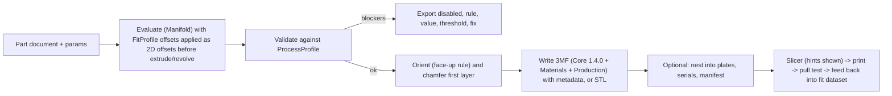

# 3D printing pipeline

**Purpose.** How a part becomes a validated, calibrated, printable file: the fit and process profile data model, the calibration coupon workflow, the validator rules with thresholds, orientation and support strategy, colour and multi-material handling in 3MF, batch print plates, CLI commands, slicer guidance, materials, and the clutch test protocol that defines success. Numbers come from [04](04-brick-geometry-spec.md).

## Contents

1. Principle: compensation lives in geometry
2. Pipeline stages
3. Profile data model
4. Calibration coupon and wizard
5. Validator rules
6. Orientation, supports, hollow roofs
7. Colour and multi-material in 3MF
8. Batch print plates
9. CLI
10. Slicer guidance
11. Materials
12. Clutch test protocol and the shared fit dataset

## 1. Principle: compensation lives in geometry

Slicers disagree: OrcaSlicer and Bambu Studio split hole versus contour compensation and offer "precise wall"; PrusaSlicer has a single XY size compensation that also moves holes, and its 3.0 rewrite is still alpha. Users share files across slicers. Bricks need different offsets for studs (outer), tube bores (inner vertical), horizontal Technic holes (undersize and oval) and the first layer. We decided (D19) that every feature takes its offsets from a `FitProfile` and the exported mesh is already compensated. Slicer settings are advisory hints we print next to the download.

## 2. Pipeline stages



## 3. Profile data model

Two documents, both JSON, both versioned, both shareable in the community dataset.

**ProcessProfile** describes what a process can resolve. Shipped defaults: `fdm-0.4`, `fdm-0.2`, `resin-msla` (experimental), `sls-mjf` (experimental).

```json
{
  "openbrick": "1.0",
  "kind": "process",
  "id": "fdm-0.4",
  "name": "FDM, 0.4 mm nozzle, 0.16-0.2 mm layers",
  "lineWidthMm": 0.4,
  "layerHeightMm": [0.16, 0.2],
  "minWallMm": 0.8,
  "wallQuantiseMm": 0.4,
  "minFeatureMm": 0.8,
  "minFeatureRule": "2 x lineWidthMm",
  "minTubeWallMm": 0.7,
  "minCavityDepthMm": 1.8,
  "minReliefHeightMm": 0.4,
  "maxReliefHeightMm": 1.5,
  "minRoofMm": 1.0,
  "maxUnsupportedBridgeMm": 12,
  "maxOverhangDeg": 50,
  "firstLayerChamferMm": 0.2,
  "studTopChamferMm": 0.25,
  "wallRoofFilletMm": { "brick": 2.0, "plate": 0.3 },
  "supportsAllowed": false,
  "horizontalHoleStrategy": "polyhole",
  "horizontalHoleStrategies": ["polyhole", "ellipse", "teardrop"],
  "tessellation": { "studSegments": 64, "minEdgeMm": 0.05 }
}
```

**FitProfile** describes one printer, nozzle and material combination after calibration.

```json
{
  "openbrick": "1.0",
  "kind": "fit",
  "id": "ndn-mk4s-petg-0.4",
  "process": "fdm-0.4",
  "printer": "Prusa MK4S",
  "nozzleMm": 0.4,
  "material": { "type": "PETG", "brand": "Prusament", "colour": "any" },
  "slicer": "PrusaSlicer 2.9.6",
  "intent": "fits-genuine-bricks",
  "offsetsMm": {
    "studDiameter": 0.00,
    "tubeInnerDiameter": 0.15,
    "tubeOuterDiameter": 0.15,
    "ribDepth": 0.10,
    "pinDiameter": -0.10,
    "horizontalHoleDiameter": 0.20,
    "axleHole": 0.06,
    "barDiameter": -0.04,
    "clipOpening": 0.04,
    "firstLayerChamfer": 0.2,
    "xyScale": 1.0
  },
  "calibration": {
    "couponVersion": 1,
    "chosenCells": { "stud": 4.80, "tube": 4.95, "pocketTubeOD": 6.65, "pocketRib": 0.40, "technicH": 5.00, "pin": 4.70, "axle": 4.86, "bar": 3.14, "clip": 3.22 },
    "date": "2026-11-12",
    "pullTestN": 2.7
  },
  "notes": "0.16 mm layers, 3 walls, 100% flow calibrated"
}
```

Rules: part files never contain printer offsets; fit-critical features are listed in the part document; batch export refuses to run without a `FitProfile` whose `process` matches and whose `calibration.chosenCells` covers every fit-critical connector type in the part; the tube outer diameter grows with the bore offset so the tube wall never drops below `minTubeWallMm`; every exported 3MF embeds the fit profile id, content hash and generator version as metadata so a printed part can be traced.

## 4. Calibration coupon and wizard

`openbrick calibrate coupon --process fdm-0.4` generates a part with two identical rows (repeatability) of:

| Row | Sweep | Step |
|-----|-------|------|
| Studs (male) | OD 4.60 to 4.95 mm | 0.05 mm |
| Tube bores (female, vertical; what a stud of a brick below enters) | ID 4.80 to 5.05 mm | 0.05 mm |
| 2x2 pockets (one tube plus four wall ribs; what a brick's studs grip when the tile sits on top) | tube OD 6.40 to 6.65 mm crossed with rib depth 0.2 to 0.5 mm | 0.05 mm |
| Horizontal Technic holes | ID 4.80 to 5.10 mm | 0.05 mm |
| Technic pins (male) | OD 4.65 to 4.90 mm | 0.05 mm |
| Axles (male) | across tips 4.60 to 4.85 mm | 0.05 mm |
| Axle holes | envelope 4.75 to 5.00 mm | 0.05 mm |
| Bar and clip pair | Ø3.14 to 3.26 bar; 3.14 to 3.30 clip | 0.04 mm |

The pocket row matters most: in aligned stacking a stud of the brick below sits between the tube outside and the wall ribs (stud-to-tube centre distance 4 x sqrt 2 = 5.657 mm minus stud radius 2.4 mm = 3.257 mm, the tube radius), so the pull test in section 12 measures tube OD and rib depth, not the bore. The bore row matters when a printed brick sits on top of genuine studs.

Each cell has an embossed label (relief 0.6 mm, stroke 0.8 mm). The user prints it, pushes genuine bricks and pins onto each cell, and records the best fit in the wizard (tap the cell, or `openbrick calibrate record --stud 4.80 --tube 4.95 ...`). The wizard writes the `FitProfile` with offsets = chosen cell minus nominal (in the example above: stud 4.80 minus 4.80 = 0.00; tube 4.95 minus 4.80 = plus 0.15; pin 4.70 minus 4.80 = minus 0.10). An optional fine pass regenerates a coupon in 0.02 mm steps around the chosen cells; 0.01 mm steps are below FDM repeatability and are not offered.

First-run: the desktop app and PWA show the wizard before the first export. "Skip for now" is allowed for non-fit-critical parts (a mosaic with no studs) and blocked otherwise.

## 5. Validator rules

Every rule has an id, severity, threshold source and a fix hint. Blockers disable export.

| Rule id | Check | Threshold | Severity |
|---------|-------|-----------|----------|
| `MESH.MANIFOLD` | mesh is watertight and manifold (Manifold status) | must pass | blocker |
| `MESH.SELF_INTERSECT` | no self-intersections after union | must pass | blocker |
| `MESH.VOLUME` | volume > 0 and matches expected within 5 percent of the nominal feature sum | 5 % | warning |
| `WALL.MIN` | thinnest body wall (2D offset test: inset by minWall/2 removes no region); tube and hollow-stud walls are excluded here and tested by `TUBE.WALL` | ProcessProfile.minWallMm | blocker |
| `TUBE.WALL` | tube wall (OD minus ID) / 2 and hollow-stud wall after offsets | minTubeWallMm 0.7 (warning below 0.8) | blocker below threshold |
| `CAVITY.DEPTH` | cavity depth under the roof, including locally thickened regions under deboss or serial | minCavityDepthMm 1.8 (stud 1.7 plus 0.1) | blocker |
| `WALL.QUANTISED` | side walls are multiples of lineWidth | wallQuantiseMm | warning |
| `ROOF.MIN` | top thickness over cavities, measured after the body thickens the roof locally under deboss and serial regions by their depth | minRoofMm | blocker |
| `ROOF.BRIDGE` | unsupported span over tubes | maxUnsupportedBridgeMm | warning |
| `OVERHANG.MAX` | faces below the roof exceed maxOverhangDeg without support; faces whose bridge span is at most maxUnsupportedBridgeMm (horizontal holes, counterbores, short bridges) are exempt and reported by `OVERHANG.BRIDGED` | maxOverhangDeg | blocker if supportsAllowed is false |
| `OVERHANG.BRIDGED` | short bridged overhangs such as the ceiling of a horizontal Technic hole | maxUnsupportedBridgeMm | warning |
| `FEATURE.MIN` | emboss or deboss stroke after morphological opening | minFeatureMm; report removed area percent | blocker if a fit-critical label; warning otherwise |
| `RELIEF.HEIGHT` | relief within [minReliefHeightMm, maxReliefHeightMm] | | warning |
| `FIT.PROCESS` | the FitProfile process matches the part's allowed processes | | blocker |
| `FIT.MISSING` | a fit-critical feature of connector type T is present and `calibration.chosenCells[T]` is absent (studs need `stud`; tube fields need `tube`, `pocketTubeOD` and `pocketRib`; Technic holes need `technicH`; pins `pin`; axles `axle`; bars and clips `bar` and `clip`) | | blocker |
| `CLUTCH.RISK` | stud or tube geometry falls outside the coupon sweep (stud 4.60 to 4.95, bore 4.80 to 5.05, tube OD 6.40 to 6.65) after offsets | | warning |
| `ORIENT.FACE` | the declared "up" face is flat and has no studs when inlay mode | | blocker |
| `TRADEMARK.LOGO` | uploaded artwork matches the blocklist (LEGO marks, minifigure silhouette) | | warning until the Q16 spike passes; then blocker (see [12](12-legal-and-naming.md)) |
| `SIZE.BED` | part fits the bed in the chosen orientation | bed size | blocker |

The validator runs on the compensated mesh and on the 2D cross-sections (cheaper and more precise for wall and feature checks). Rules that would merely re-check geometry the evaluator built from the profile (for example that a stud equals its chosen cell) are evaluator unit tests, not user-facing rules. Signature: `validate(&Built, &ProcessProfile, Option<&FitProfile>) -> Report`.

## 6. Orientation, supports, hollow roofs

- Default: studs up, flat bottom on the bed, **no supports**. Tubes and pins print as vertical cylinders; the roof bridges between tube tops and walls. On brick-height bodies a 2 mm fillet (or 45° chamfer when fillets are off) at the wall-to-roof joint anchors bridges (Strathclyde tested a 9.6 mm brick); on plate-height bodies the cavity is only about 2.2 mm deep and the stud top sits 0.5 mm below the roof, so the fillet is capped at 0.3 mm or omitted.
- Deboss and serials on thin bodies: the body thickens the roof locally under a deboss or serial region by the relief depth, and `CAVITY.DEPTH` requires at least 1.8 mm of cavity to remain (stud 1.7 mm plus 0.1 mm). On plate-height parts that caps deboss and underside serials at 0.4 mm; the designer clamps `reliefHeight` accordingly when `relief` is `deboss`.
- Inlay mode (two-colour logo): face **down** on the bed. For a single-extruder filament swap the exported `accent` object is the face slab (thickness = relief depth) **minus** the logo, and the logo is a recess that shows the body colour, so a swap after the slab layers colours the face and leaves the logo in the body colour (if both the slab and the logo lay on the bed in the same layers, a swap would colour them identically). For multi-material units the logo fill is exported as its own object instead, so each gets a slot. The validator requires the face to be flat and stud-free.
- Keychain loops and off-grid decorations are generated with a 45° chamfer underneath so they print without supports.
- Horizontal Technic holes: `polyhole` (polygon with corrected circumradius), `ellipse` (0.2 mm taller) or `teardrop` (pointed ceiling, no overhang); chosen by the ProcessProfile. Polyhole corrects diameter, not overhang; the hole ceiling is a bridge of at most 4.8 mm and is reported by `OVERHANG.BRIDGED`, never blocked.
- First layer: a 0.2 mm 45° chamfer on bottom edges replaces slicer elephant-foot compensation.

## 7. Colour and multi-material in 3MF

- Writer targets 3MF Core 1.4.0 (3MF is standardised as ISO/IEC 25422:2025), Materials and Properties 1.2.1 (colour groups, per-object and per-triangle colour), Production 1.1.2 (whose text calls itself v1.2; UUIDs). Units millimetres; Z-up.
- One object per colour role (`body`, `accent`, `serial`) in the part designer; per-part objects under one component object in whole-model export, with an explicit **fuse** option that unions same-colour groups for single-material printing. The spec says producers should not emit overlapping objects, so fuse is a boolean union, not an overlap.
- Metadata: `openbrick:partId`, `openbrick:version`, `openbrick:contentHash`, `openbrick:fitProfile`, `openbrick:generator`, `openbrick:serial`.
- Vendor flavours (Bambu/Orca project 3MF with painted colours) are a plugin, version-pinned to the slicer release they were reverse-engineered from, off by default.
- CI validates every exporter fixture with lib3mf 2.5.0 (BSD-2) and opens it in OrcaSlicer CLI as a smoke test.

## 8. Batch print plates

A **run document** (`.obrun.json`) names a part, a parameter table (inline or CSV), plate constraints and naming:

```json
{
  "openbrick": "1.0",
  "kind": "run",
  "part": "ndn.logo-tile@1.2.0",
  "rowsFrom": "csv:customers.csv",
  "map": { "logo": "logo_path", "text": "name" },
  "fitProfile": "ndn-mk4s-petg-0.4",
  "bed": { "xMm": 250, "yMm": 210, "spacingMm": 3 },
  "orientation": "part.print.up",
  "serial": { "mode": "deboss", "face": "bottom", "pattern": "{sku}-{serial:04}" },
  "filename": "{sku}-plate{plate:02}.3mf",
  "manifest": "manifest.csv"
}
```

Nesting is a grid-aware shelf packer (parts are rectangles in LDU, so packing is fast and deterministic); output is one 3MF per plate with named objects plus a CSV manifest (serial, params hash, plate, filename). Re-runs with identical inputs produce byte-identical plates. An optional hand-off runs `orca-slicer --arrange 1 --orient 1 --export-3mf` out of process.

QR codes need 0.9 to 1.2 mm modules (about 40 to 60 mm overall) and so only fit faces of at least 5x5 studs; Data Matrix is the compact option; a debossed serial on the underside is the default.

## 9. CLI

```
openbrick build part.obpart.json --params size=2x4 logo=./mark.svg --fit ndn-mk4s-petg-0.4 --out tile.3mf
openbrick validate tile.obpart.json --process fdm-0.4 --json
openbrick calibrate coupon --process fdm-0.4 --out coupon.3mf
openbrick calibrate record --process fdm-0.4 --printer "Prusa MK4S" --material PETG --stud 4.80 --tube 4.95 --technic-h 5.00
openbrick run customers.obrun.json --out plates/
openbrick convert model.obrick --to mpd
openbrick convert model.obrick --to 3mf --fuse
openbrick catalog fetch            # downloads and verifies the LDraw library into the cache
openbrick serve --qr               # serves the PWA on the LAN and prints a QR code
```

All commands are scriptable (`--json` output, non-zero exit on blockers) so print farms can run them from cron.

## 10. Slicer guidance

Shown next to every export as text, never relied upon:

- **OrcaSlicer 2.4.x / Bambu Studio 2.8.x:** precise wall on; X-Y hole compensation 0; X-Y contour compensation 0 (already in geometry); 3 walls; 0.16 or 0.2 mm layers; no supports; elephant-foot compensation 0 (chamfer is in geometry).
- **PrusaSlicer 2.9.x:** XY size compensation 0; elephant foot 0; 3 perimeters; 0.16 mm layers; "detect bridging perimeters" on.
- **Cura:** horizontal expansion 0; initial layer horizontal expansion 0.
- Print the coupon once per material spool brand; re-record if the fit drifts.

## 11. Materials

| Material | Role | Notes |
|----------|------|-------|
| PETG | default "play" material | durable clutch, low shrinkage (0.1 to 0.2 %) |
| ABS / ASA | closest to moulded clutch | shrinkage 0.5 to 0.8 %; enclosure helps |
| PLA | calibration and prototypes | easiest; creeps over time (axle holes loosen after about a year) |
| Tough / ABS-like resin | experimental | standard resin is too brittle; needs its own sweep dataset |
| SLS / MJF nylon | service-bureau profile, experimental | ±0.3 mm; walls 0.7 to 0.8 mm supported; powder escape holes for hollow parts |

## 12. Clutch test protocol and the shared fit dataset

- **Pull test:** a printed 2x4 tile pressed fully onto a genuine 2x4 brick; a 0 to 50 N force gauge (a luggage scale is at its floor at 2 to 4 N and is not accepted) pulls vertically; record the separation force. **Control first:** measure genuine 2x4 on genuine 2x4 on the same rig (literature says about 2.5 to 3 N, Kollsker and Malaguti 2021, but one uncited community figure is far higher, so the rig is calibrated by its own control). Pass for "fits genuine bricks": median of three pulls within 0.7 to 1.5 times the control median. The test loads the pocket row (tube OD and ribs), which is why that row exists in the coupon.
- **Dataset:** `fit-profiles/` repository (CC0) keyed by printer, nozzle, material brand, slicer: offsets, chosen cells, pull-test median, date, contributor credit. New users start from the nearest profile instead of calibrating from scratch; the app suggests a coupon print to confirm.
- **Success metric:** 9 of 10 first calibrated prints pass the pull test at MVP; 19 of 20 at 1.0 ([01](01-product-vision-and-pillars.md)).
