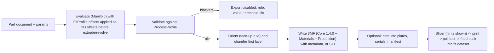

# 3D printing pipeline

**Purpose.** How a part becomes a validated, calibrated, printable file: the fit and process profile data model, the calibration coupon workflow, the validator rules with thresholds, orientation and support strategy, colour and multi-material handling in 3MF, batch print plates, CLI commands, slicer guidance, materials, and the clutch test protocol that defines success. Numbers come from [04](04-brick-geometry-spec.md).

## Contents

1. Principle: compensation lives in geometry
2. Pipeline stages
3. Profile data model
4. Calibration coupon and wizard
5. Validator rules
6. Orientation, supports, hollow roofs
7. Colour and multi-material in 3MF
8. Batch print plates
9. CLI
10. Slicer guidance
11. Materials
12. Clutch test protocol and the shared fit dataset

## 1. Principle: compensation lives in geometry

Slicers disagree: OrcaSlicer and Bambu Studio split hole versus contour compensation and offer "precise wall"; PrusaSlicer has a single XY size compensation that also moves holes, and its 3.0 rewrite is still alpha. Users share files across slicers. Bricks need different offsets for studs (outer), tube bores (inner vertical), horizontal Technic holes (undersize and oval) and the first layer. We decided (D19) that every feature takes its offsets from a `FitProfile` and the exported mesh is already compensated. Slicer settings are advisory hints we print next to the download.

## 2. Pipeline stages



## 3. Profile data model

Two documents, both JSON, both versioned, both shareable in the community dataset.

**ProcessProfile** describes what a process can resolve. Shipped defaults: `fdm-0.4`, `fdm-0.2`, `resin-msla` (experimental), `sls-mjf` (experimental).

```json
{
  "openbrick": "1.0",
  "kind": "process",
  "id": "fdm-0.4",
  "name": "FDM, 0.4 mm nozzle, 0.16-0.2 mm layers",
  "lineWidthMm": 0.42,
  "layerHeightMm": [0.16, 0.2],
  "minWallMm": 0.8,
  "wallQuantiseMm": 0.4,
  "minFeatureMm": 0.8,
  "minReliefHeightMm": 0.4,
  "maxReliefHeightMm": 1.5,
  "minRoofMm": 1.0,
  "maxUnsupportedBridgeMm": 12,
  "maxOverhangDeg": 50,
  "firstLayerChamferMm": 0.2,
  "studTopChamferMm": 0.25,
  "wallRoofFilletMm": 2.0,
  "supportsAllowed": false,
  "horizontalHoleStrategy": "polyhole",
  "tessellation": { "studSegments": 64, "minEdgeMm": 0.05 }
}
```

**FitProfile** describes one printer, nozzle and material combination after calibration.

```json
{
  "openbrick": "1.0",
  "kind": "fit",
  "id": "ndn-mk4s-petg-0.4",
  "process": "fdm-0.4",
  "printer": "Prusa MK4S",
  "nozzleMm": 0.4,
  "material": { "type": "PETG", "brand": "Prusament", "colour": "any" },
  "slicer": "PrusaSlicer 2.9.6",
  "intent": "fits-genuine-bricks",
  "offsetsMm": {
    "studDiameter": -0.12,
    "tubeInnerDiameter": 0.08,
    "pinDiameter": -0.10,
    "horizontalHoleDiameter": 0.20,
    "axleHole": 0.06,
    "barDiameter": -0.04,
    "clipOpening": 0.04,
    "firstLayerChamfer": 0.2,
    "xyScale": 1.0
  },
  "calibration": {
    "couponVersion": 1,
    "chosenCells": { "stud": 4.80, "tube": 4.95, "technicH": 5.00 },
    "date": "2026-11-12",
    "pullTestN": 2.7
  },
  "notes": "0.16 mm layers, 3 walls, 100% flow calibrated"
}
```

Rules: part files never contain printer offsets; fit-critical features are listed in the part document; batch export refuses to run without a `FitProfile` whose `process` matches and whose `calibration` block is present; every exported 3MF embeds the fit profile id, content hash and generator version as metadata so a printed part can be traced.

## 4. Calibration coupon and wizard

`openbrick calibrate coupon --process fdm-0.4` generates a part with two identical rows (repeatability) of:

| Row | Sweep | Step |
|-----|-------|------|
| Studs (male) | OD 4.70 to 4.95 mm | 0.05 mm |
| Tube bores (female, vertical) | ID 4.80 to 5.05 mm | 0.05 mm |
| Horizontal Technic holes | ID 4.80 to 5.10 mm | 0.05 mm |
| Axle holes | envelope 4.75 to 5.00 mm | 0.05 mm |
| Bar and clip pair | Ø3.14 to 3.26 bar; 3.14 to 3.30 clip | 0.04 mm |

Each cell has an embossed label (relief 0.6 mm, stroke 0.8 mm). The user prints it, pushes genuine bricks and pins onto each cell, and records the best fit in the wizard (tap the cell, or `openbrick calibrate record --stud 4.80 --tube 4.95 ...`). The wizard writes the `FitProfile` with offsets = chosen minus nominal. An optional fine pass regenerates a coupon in 0.02 mm steps around the chosen cells; 0.01 mm steps are below FDM repeatability and are not offered.

First-run: the desktop app and PWA show the wizard before the first export. "Skip for now" is allowed for non-fit-critical parts (a mosaic with no studs) and blocked otherwise.

## 5. Validator rules

Every rule has an id, severity, threshold source and a fix hint. Blockers disable export.

| Rule id | Check | Threshold | Severity |
|---------|-------|-----------|----------|
| `MESH.MANIFOLD` | mesh is watertight and manifold (Manifold status) | must pass | blocker |
| `MESH.SELF_INTERSECT` | no self-intersections after union | must pass | blocker |
| `MESH.VOLUME` | volume > 0 and matches expected within 5 percent of the nominal feature sum | 5 % | warning |
| `WALL.MIN` | thinnest wall (2D offset test: inset by minWall/2 removes no region) | ProcessProfile.minWallMm | blocker |
| `WALL.QUANTISED` | side walls are multiples of lineWidth | wallQuantiseMm | warning |
| `ROOF.MIN` | top thickness over cavities | minRoofMm | blocker |
| `ROOF.BRIDGE` | unsupported span over tubes | maxUnsupportedBridgeMm | warning |
| `OVERHANG.MAX` | faces below the roof exceed maxOverhangDeg without support | maxOverhangDeg | blocker if supportsAllowed is false |
| `FEATURE.MIN` | emboss or deboss stroke after morphological opening | minFeatureMm; report removed area percent | blocker if a fit-critical label; warning otherwise |
| `RELIEF.HEIGHT` | relief within [minReliefHeightMm, maxReliefHeightMm] | | warning |
| `FIT.WINDOW` | stud, tube, pin, hole offsets are within the calibrated window of the FitProfile | ±0.05 mm of chosen cell | blocker for fit-critical features |
| `FIT.MISSING` | fit-critical feature present and no calibrated FitProfile | | blocker |
| `CLUTCH.RISK` | stud or tube geometry falls outside 4.70 to 4.95 / 4.80 to 5.05 after offsets | | warning |
| `ORIENT.FACE` | the declared "up" face is flat and has no studs when inlay mode | | blocker |
| `TRADEMARK.LOGO` | uploaded artwork matches the blocklist (LEGO marks, minifigure silhouette) | | blocker (see [12](12-legal-and-naming.md)) |
| `SIZE.BED` | part fits the bed in the chosen orientation | bed size | blocker |
| `TOLERANCE.STACK` | n-stud length is 8n minus 0.2 within ±0.05 | | warning |

The validator runs on the compensated mesh and on the 2D cross-sections (cheaper and more precise for wall and feature checks).

## 6. Orientation, supports, hollow roofs

- Default: studs up, flat bottom on the bed, **no supports**. Tubes and pins print as vertical cylinders; the roof bridges between tube tops and walls. A 2 mm fillet (or 45° chamfer when fillets are off) at the wall-to-roof joint anchors bridges.
- Inlay mode (two-colour logo without a multi-material printer): face **down** on the bed; the logo body is a separate 3MF object with colour role `accent` so the slicer pauses for a filament swap or assigns an AMS slot. The validator requires the face to be flat and stud-free.
- Keychain loops and off-grid decorations are generated with a 45° chamfer underneath so they print without supports.
- Horizontal Technic holes: `polyhole` strategy (polygon with corrected circumradius) or a 0.2 mm larger slightly elliptical hole; chosen by the ProcessProfile.
- First layer: a 0.2 mm 45° chamfer on bottom edges replaces slicer elephant-foot compensation.

## 7. Colour and multi-material in 3MF

- Writer targets 3MF Core 1.4.0 (ISO/IEC 25422:2025), Materials and Properties 1.2.1 (colour groups, per-object and per-triangle colour), Production 1.2 (UUIDs). Units millimetres; Z-up.
- One object per colour role (`body`, `accent`, `serial`) in the part designer; per-part objects under one component object in whole-model export, with an explicit **fuse** option that unions same-colour groups for single-material printing. The spec says producers should not emit overlapping objects, so fuse is a boolean union, not an overlap.
- Metadata: `openbrick:partId`, `openbrick:version`, `openbrick:contentHash`, `openbrick:fitProfile`, `openbrick:generator`, `openbrick:serial`.
- Vendor flavours (Bambu/Orca project 3MF with painted colours) are a plugin, version-pinned to the slicer release they were reverse-engineered from, off by default.
- CI validates every exporter fixture with lib3mf 2.5.0 (BSD-2) and opens it in OrcaSlicer CLI as a smoke test.

## 8. Batch print plates

A **run document** (`.obrun.json`) names a part, a parameter table (inline or CSV), plate constraints and naming:

```json
{
  "openbrick": "1.0",
  "kind": "run",
  "part": "ndn.logo-tile@1.2.0",
  "rowsFrom": "csv:customers.csv",
  "map": { "logo": "logo_path", "text": "name" },
  "fitProfile": "ndn-mk4s-petg-0.4",
  "bed": { "xMm": 250, "yMm": 210, "spacingMm": 3 },
  "orientation": "part.print.up",
  "serial": { "mode": "deboss", "face": "bottom", "pattern": "{sku}-{serial:04}" },
  "filename": "{sku}-plate{plate:02}.3mf",
  "manifest": "manifest.csv"
}
```

Nesting is a grid-aware shelf packer (parts are rectangles in LDU, so packing is fast and deterministic); output is one 3MF per plate with named objects plus a CSV manifest (serial, params hash, plate, filename). Re-runs with identical inputs produce byte-identical plates. An optional hand-off runs `orca-slicer --arrange 1 --orient 1 --export-3mf` out of process.

QR codes need 0.9 to 1.2 mm modules (about 40 to 60 mm overall) and so only fit faces of at least 5x5 studs; Data Matrix is the compact option; a debossed serial on the underside is the default.

## 9. CLI

```
openbrick build part.obpart.json --params size=2x4 logo=./mark.svg --fit ndn-mk4s-petg-0.4 --out tile.3mf
openbrick validate tile.obpart.json --process fdm-0.4 --json
openbrick calibrate coupon --process fdm-0.4 --out coupon.3mf
openbrick calibrate record --process fdm-0.4 --printer "Prusa MK4S" --material PETG --stud 4.80 --tube 4.95 --technic-h 5.00
openbrick run customers.obrun.json --out plates/
openbrick convert model.obrick --to mpd
openbrick convert model.obrick --to 3mf --fuse
openbrick catalog fetch            # downloads and verifies the LDraw library into the cache
openbrick serve --qr               # serves the PWA on the LAN and prints a QR code
```

All commands are scriptable (`--json` output, non-zero exit on blockers) so print farms can run them from cron.

## 10. Slicer guidance

Shown next to every export as text, never relied upon:

- **OrcaSlicer 2.4.x / Bambu Studio 2.8.x:** precise wall on; X-Y hole compensation 0; X-Y contour compensation 0 (already in geometry); 3 walls; 0.16 or 0.2 mm layers; no supports; elephant-foot compensation 0 (chamfer is in geometry).
- **PrusaSlicer 2.9.x:** XY size compensation 0; elephant foot 0; 3 perimeters; 0.16 mm layers; "detect bridging perimeters" on.
- **Cura:** horizontal expansion 0; initial layer horizontal expansion 0.
- Print the coupon once per material spool brand; re-record if the fit drifts.

## 11. Materials

| Material | Role | Notes |
|----------|------|-------|
| PETG | default "play" material | durable clutch, low shrinkage (0.1 to 0.2 %) |
| ABS / ASA | closest to moulded clutch | shrinkage 0.5 to 0.8 %; enclosure helps |
| PLA | calibration and prototypes | easiest; creeps over time (axle holes loosen after about a year) |
| Tough / ABS-like resin | experimental | standard resin is too brittle; needs its own sweep dataset |
| SLS / MJF nylon | service-bureau profile, experimental | ±0.3 mm; walls 0.7 to 0.8 mm supported; powder escape holes for hollow parts |

## 12. Clutch test protocol and the shared fit dataset

- **Pull test:** a printed 2x4 tile pressed fully onto a genuine 2x4 brick; a luggage scale or a force gauge pulls vertically; record the separation force. Reference: 2.5 to 3 N for two genuine 2x4 bricks. Pass band for "fits genuine bricks": 2 to 4 N. Record three pulls, report the median.
- **Dataset:** `fit-profiles/` repository (CC0) keyed by printer, nozzle, material brand, slicer: offsets, chosen cells, pull-test median, date, contributor credit. New users start from the nearest profile instead of calibrating from scratch; the app suggests a coupon print to confirm.
- **Success metric:** 9 of 10 first calibrated prints pass the pull test at MVP; 19 of 20 at 1.0 ([01](01-product-vision-and-pillars.md)).
