# Roadmap

**Purpose.** Milestones M0 to M6 with weeks, scope, deliverables, demo criteria and dependencies; the MVP definition; what is deliberately deferred; team assumptions; and the checkpoints where the plan is revisited.

## Team assumptions

We assume 2 to 4 engineers using AI-assisted coding, one of whom owns geometry and print, one the web UI and shells, with the founder on product and merchandise; community contributors join from M1 when the CLI gives them a real artifact. Weeks are calendar weeks at that staffing; with two engineers, add about 30 percent to M3 onwards.

## MVP definition

**One journey, end to end, by week 16:** calibrate a printer with the coupon, design a 2x4 logo tile from an SVG on desktop (or from the CLI), pass validation, export 3MF, print, and have the tile clutch onto standard bricks with a pull-test median in the 2 to 4 N band. Nine of ten first calibrated prints pass. This proves the Dimensional Standard, the kernel, the part document, the fit profiles, the validator, the 3MF writer, the Tauri shell and the CLI together.

## Milestones

| Milestone | Weeks | Scope | Demo criterion |
|-----------|-------|-------|----------------|
| **M0 Foundations and spikes** | 1 to 3 | Register names and accounts; repo scaffold, CI, licence policy, CLAUDE.md; `standards/dimensions-v1.json`; kernel spike: manifold-rust vs manifold-csg on a brick corpus; device render harness on six devices; UI framework spike; connectivity-from-primitives spike on 200 LDraw parts; measurement program starts | Conformance corpus passes on at least one Rust kernel; harness CSV published; D02 and D12 confirmed or amended |
| **M1 Part core and CLI alpha** | 4 to 9 | `openbrick-units`, `-geom`, `-part` (body.*, stud.field, tube.field, relief.svg, relief.text, round tiers 1 and 2), `-print` (profiles, validator, coupon, record), `-io` (3MF, STL); CLI `build`, `validate`, `calibrate`; `dist` release 0.1 on all channels in the M1 row of [09](09-platforms-and-distribution.md) | From a terminal: print coupon, record fit, build a logo tile, 3MF opens in OrcaSlicer with colours; CLI installable on three OSes |
| **M2 Desktop designer alpha (MVP)** | 10 to 16 | Tauri shell, viewport, typed param panel with manipulators, live preview, validation panel, calibration wizard, export; LDraw `.dat` with SNAP export; OpenSCAD customizer import; fonts screen; trademark guard | The MVP journey on Windows, macOS and Linux; 9 of 10 pull tests pass; release 0.2 with DMG, NSIS/MSI, AppImage |
| **M3 Assembler alpha** | 17 to 24 | `openbrick-catalog` (download, pack, parser, primitive scanning, LODs, masks), `openbrick-engine` (tables, hashes, snapping, collision, graph, commands), `.obrick`, `.ldr/.mpd` round-trip, whole-model 3MF, chunked instancing with LOD, desktop input; CRDT benchmark | Import a 10k-part `.mpd`, build on it at 60 fps on an Iris Xe laptop, save, re-export losslessly, print one subassembly; release 0.3 |
| **M4 PWA, Android, batch** | 25 to 32 | PWA with OPFS and offline; `serve --qr`; touch interaction; Android via Tauri (APK + Play closed test); batch runs (CSV, nesting, serials, manifest); Flathub, Microsoft Store, winget; Technic holes, axles, bars, clips, mosaic features | Phone opens the PWA from a QR code and builds with always-aligning snaps; a 50-tile merch run produces plates and a manifest; release 0.4 |
| **M5 iOS, community, play** | 33 to 42 | iOS via Tauri (TestFlight public link); scripted parts in the Extism sandbox; extended parts registry (Git-based, CC0/CC BY); build instructions; play mode (Rapier); connectivity dataset proposal on forums.ldraw.org; fit-profile dataset site | TestFlight build; a community script generates a part that snaps in LDCad; a tower falls over in play mode; release 0.5 |
| **M6 1.0** | 43 to 52 | App Store and Play production; STEP export service (OCCT out of process, optional); docs site complete; measurement dataset published; collaboration decision from the M3 benchmark; 100k-instance target met; security and accessibility pass; 1.0 | 19 of 20 pull tests pass; 100k bricks at 60 fps on an Iris Xe laptop and 30 fps on a Pixel 8a; all install channels live |

## Gantt

```mermaid
gantt
  title OpenBrick3D roadmap (weeks)
  dateFormat X
  axisFormat %s
  section Foundations
  M0 spikes and scaffold        :m0, 0, 3
  section Part designer and print
  M1 part core and CLI alpha    :m1, 3, 9
  M2 desktop designer (MVP)     :m2, 9, 16
  section Assembler
  M3 assembler alpha            :m3, 16, 24
  section Reach
  M4 PWA, Android, batch        :m4, 24, 32
  M5 iOS, community, play       :m5, 32, 42
  section Release
  M6 1.0                        :m6, 42, 52
```

## Dependencies and sequencing rules

- M1 depends on the M0 kernel decision; if manifold-rust fails the corpus, M1 starts on manifold-csg with no schedule change.
- M3 cannot start before the M0 connectivity spike shows at least 70 percent of common parts get usable connectors from primitives; otherwise M3 adds two weeks for hand-authoring the top 500 parts.
- M4 Android depends on the Play organisation account (start in M0).
- M5 iOS depends on the Apple Developer Program enrolment (start in M0) and on the M0 WKWebView WebGPU test deciding the renderer path.
- Mobile stores take every second desktop release.

## Deliberately deferred

Real-time collaboration (decision at M6 from the M3 benchmark); native wgpu renderer (after M3 webview numbers); Godot or Bevy play-mode client (year 2 to 3); Studio `.io` reader; resin and SLS profiles out of experimental (need datasets); a hosted marketplace for parts (business and DSA decision); minifigure-anything (never).

## Checkpoints

| When | Question | Owner |
|------|----------|-------|
| End of M0 | Kernel, UI framework, renderer path on mobile confirmed? | engineering |
| End of M2 | Did the MVP journey pass 9 of 10? If not, M3 waits and M2 extends. | founder |
| End of M3 | Webview rendering good enough on Linux and Android, or start the wgpu renderer? CRDT yes or no for 1.x? | engineering |
| End of M4 | Is the merch batch flow earning? Reprioritise M5 scope accordingly. | founder |
| End of M5 | Community uptake: contributors, parts, fit profiles; adjust 1.0 scope. | founder |
