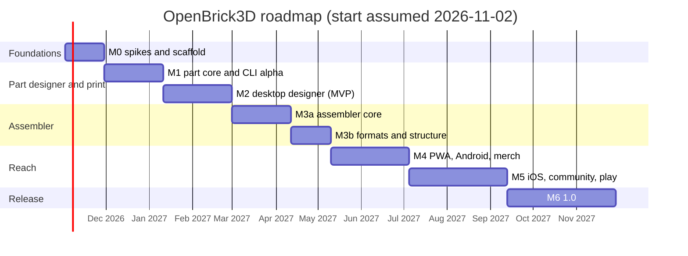

# Roadmap

**Purpose.** Milestones M0 to M6 with weeks, scope, deliverables, demo criteria and dependencies; the MVP definition; what is deliberately deferred; team assumptions; and the checkpoints where the plan is revisited.

## Team assumptions

We assume three engineers using AI-assisted coding (one owns geometry and print, one the web UI and shells, one the engine and formats), with the founder on product and merchandise; community contributors join from M1 when the CLI gives them a real artifact. Weeks are calendar weeks at that staffing. With two engineers add about 30 percent to every milestone (MVP at about week 22, 1.0 at about week 73); with four, M3 and M4 can overlap.

## MVP definition

**One journey, end to end, by week 17 (three engineers):** calibrate a printer with the coupon, design a 2x4 logo tile from an SVG on desktop (or from the CLI), pass validation, export 3MF, print, and have the tile clutch onto standard bricks with a pull-test median in the 2 to 4 N band. Nine of ten first calibrated prints pass. This proves the Dimensional Standard, the kernel, the part document, the fit profiles, the validator, the 3MF writer, the Tauri shell and the CLI together.

## Milestones

| Milestone | Weeks | Scope | Demo criterion |
|-----------|-------|-------|----------------|
| **M0 Foundations and spikes** | 1 to 4 | Register names and accounts; repo scaffold, CI, licence policy, CLAUDE.md, GOVERNANCE.md, SECURITY.md; `standards/dimensions-v1.json`; kernel spike: manifold-rust vs manifold-csg vs manifold-3d on the M0 corpus (brick primitives plus a Thingi10K subset); device render harness on the six devices listed in [09, costs](09-platforms-and-distribution.md#9-yearly-costs); UI framework spike; connectivity-from-primitives spike using a throwaway script over raw `.dat` files (no catalog crate yet); measurement program starts | Corpus passes on at least one Rust kernel; harness CSV published; D02 and D12 confirmed or amended |
| **M1 Part core and CLI alpha** | 5 to 10 | `openbrick-units`, `-geom`, `-part` (body.tile, body.plate, stud.field, tube.field, relief.svg, chamfer rounding only), `-print` (fdm-0.4 profile, coupon, record, rules MESH.*, WALL.MIN, ROOF.MIN, FEATURE.MIN, FIT.*), `-io` (3MF, STL); CLI `build`, `validate`, `calibrate`; `dist` release 0.1 on curl pipe sh, PowerShell and cargo-binstall only | From a terminal: print coupon, record fit, build a logo tile, 3MF opens in OrcaSlicer with colours; CLI installable on three OSes |
| **M2 Desktop designer alpha (MVP)** | 11 to 17 | Tauri shell (WASM worker plus file dialogs only), viewport, typed param panel, live preview, validation panel, calibration wizard, 3MF export; remaining validator rules; npm, uv, Homebrew tap and scoop channels | The MVP journey on Windows, macOS and Linux; 9 of 10 pull tests pass; release 0.2 with unsigned DMG, NSIS/MSI and AppImage (signed from M4) |
| **M3a Assembler core** | 18 to 23 | `openbrick-catalog` (download, pack, parser, primitive scanning, LODs, masks), `openbrick-engine` (tables, hashes, snapping, collision, commands), `.obrick`, one render path (chunked InstancedMesh on both backends) with LOD, desktop input; IPC measurement (Q07) | Import a 10k-part `.mpd` (read-only), place and snap bricks at 60 fps on an Iris Xe laptop, save and reload `.obrick` |
| **M3b Assembler formats and structure** | 24 to 27 | connection graph and structure report, lossless `.ldr/.mpd` round-trip, whole-model 3MF, LDraw `.dat` with SNAP export for designed parts, OpenSCAD customizer import, CRDT benchmark | Re-export the 10k model losslessly, print one subassembly, a designed tile snaps in LDCad; release 0.3 |
| **M4 PWA, Android, merch** | 28 to 35 | PWA with OPFS, offline and export-all backup; `serve --qr` with a token; touch interaction; Android via Tauri (APK + Play closed test); signed desktop builds; batch runs (CSV, nesting, serials, manifest); relief.text with the fonts screen; rounding tiers 2 and 3; Technic holes, axles, bars, clips, mosaic features; Flathub, Microsoft Store, winget | Phone opens the PWA from a QR code and builds with always-aligning snaps; a 50-tile merch run with text produces plates and a manifest; release 0.4 |
| **M5 iOS, community, play** | 36 to 45 | iOS via Tauri (TestFlight public link); F-Droid flavour and reproducible APK; scripted parts in the Extism sandbox; extended parts registry (Git-based, CC0/CC BY); trademark guard after the Q16 spike; build instructions; play mode (Rapier); connectivity dataset proposal on forums.ldraw.org; fit-profile dataset site; accessibility and i18n pass | TestFlight build; a community script generates a part that snaps in LDCad; a tower falls over in play mode; keyboard-only designer flow works; release 0.5 |
| **M6 1.0** | 46 to 56 | App Store and Play production; STEP export service (OCCT out of process, optional); docs site complete; measurement dataset published; collaboration decision from the M3b benchmark; 100k-instance target met; BatchedMesh-on-WebGL2 evaluation; security review; 1.0 | 19 of 20 pull tests pass; 100k bricks at 60 fps on an Iris Xe laptop and 30 fps on a Pixel 8a; all install channels live |

## Gantt

## Dependencies and sequencing rules

- M1 depends on the M0 kernel decision. If manifold-rust fails the corpus, M1 starts on manifold-csg for CLI and desktop only (its wasm32 support is provisional); web and mobile use manifold-3d (WASM) behind the same Kernel trait until manifold-rust passes; add 2 weeks to M2 and re-plan M4.
- M3a cannot start before the M0 connectivity spike shows at least 70 percent of common parts get usable connectors from primitives; otherwise M3a adds two weeks for hand-authoring the top 500 parts. Status 2026-10-28: met on the 164 parts with ground truth (84.8 percent), not yet over all 200 (69.5 percent lower bound). Before M3a starts, re-check the 36 unverified parts blind and build the clip and hinge calibration table, then rerun the spike. Add the two weeks only if the lower bound stays below 70 percent. Either way, M3a plans about 1.5 weeks for three items ([Q04 report](../spikes/q04-ldraw-connectivity.md)):
  - female stud synthesis;
  - the calibration table;
  - an override table for bars, gears with raw-geometry holes, old hinges and swivel plates, raw-geometry clips, towballs, Technic plates with holes, and wedges and wings.
- M4 Android depends on the Play organisation account (start in M0).
- M5 iOS depends on the Apple Developer Program enrolment (start in M0) and on the M4 WASM memory measurements on iOS WebKit (R15).
- Mobile stores take every second desktop release.

## Definition of done (every milestone)

A milestone is done when: every item in its scope has tests green on the full CI matrix; the user-facing parts have a docs-site page; the release artifacts for its channels are built (signed where the channel is signed); the demo criterion is recorded on video and linked from the release notes; open risks it touched are updated in [13](13-risks-and-open-questions.md).

## Deliberately deferred

Real-time collaboration (decision at M6 from the M3b benchmark); native wgpu renderer (after M3b webview numbers); Godot or Bevy play-mode client (year 2 to 3); Studio `.io` reader; resin and SLS profiles out of experimental (need datasets); a hosted marketplace for parts (business and DSA decision); minifigure-anything (never).

## Checkpoints

| When | Question | Owner |
|------|----------|-------|
| End of M0 | Kernel, UI framework, renderer path on mobile confirmed? | engineering |
| End of M2 | Did the MVP journey pass 9 of 10? If not, M3a waits and M2 extends. | founder |
| End of M3b | Webview rendering good enough on Linux and Android, or start the wgpu renderer? CRDT yes or no for 1.x? | engineering |
| End of M4 | Is the merch batch flow earning? Reprioritise M5 scope accordingly. | founder |
| End of M5 | Community uptake: contributors, parts, fit profiles; adjust 1.0 scope. | founder |
