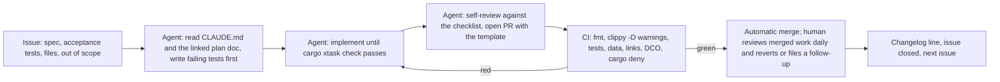

# Lean development with AI agents and limited resources

**Purpose.** How a very small team ships this plan: the operating model (humans decide, agents execute, CI judges), the shape of work agents do well and the work they must not do, the loop every task goes through, budgets for money and tokens, the weekly cadence, the first agent-ready backlog for M0 and M1, and the failure modes we already hit while producing this plan and how to avoid them. This document turns [11, roadmap](11-roadmap.md) into a way of working.

## Contents

1. Operating model
2. What agents do well here, and what they must not do
3. The task loop
4. Task shapes and the agent-ready issue
5. Guard rails that make agent output safe to merge
6. Budgets: money, tokens, time
7. Cadence
8. Staffing variants and what they cost in weeks
9. First agent-ready backlog (M0 and M1)
10. Failure modes we met while writing this plan, and the rule each produced
11. Metrics

## 1. Operating model

Three roles, whatever the head count:

| Role | Who | Owns |
|------|-----|------|
| **Decider** | the founder (product) and one engineer (technical lead) | priorities, the ADR table, after-merge review, anything that touches money, accounts, legal, or a physical print |
| **Executor** | AI coding agents (Claude Code sessions in this repository), plus any engineer's own hands | implementation of agent-ready issues, tests, docs, refactors, benchmarks, first-pass reviews |
| **Judge** | CI and the repository's own tests, then a human review | whether a change is correct, within policy, and small enough to understand |

Principles: the repository is the single source of truth and the only memory agents have (CLAUDE.md, docs/plan, tests); GitHub issues are the work queue; every merge is small; agent pull requests merge automatically when CI is green, and humans review merged work rather than gate it; a human never reviews what CI could have rejected; nothing physical, legal or financial is delegated.

## 2. What agents do well here, and what they must not do

**Delegate freely (agent-ready):** crate and package code against a written spec with tests; golden-mesh and property tests; parsers and writers (LDraw, 3MF, SVG) with fixtures; refactors that keep tests green; benchmarks and harnesses; documentation from the plan; CI and release automation; research summaries with sources; first-pass code review; triage of issues against the plan; translations.

**Delegate with a human in the loop:** anything that changes an ADR row; the Dimensional Standard; validator thresholds; public API shapes of the part document; UI flows (an agent builds, a human uses it on a real device); dependency additions (licence check by `cargo deny` plus a human glance).

**Never delegate:** printing and the pull test (a human prints the coupon and measures the control); the measurement program; trademark clearance, store accounts, signing keys, spending; store listings and the Flathub manifest (Flathub bans AI-written manifests); the final word on a contributor's pull request; anything the agent cannot verify in this repository (it must say so, not guess).

## 3. The task loop

Every task, human or agent, runs the same loop so that quality does not depend on who did it:

Rules of the loop: tests before code (the acceptance tests in the issue become the first commit); one issue, one pull request, under about 400 changed lines; the agent explains anything it could not verify; a red CI goes back to the agent, never to the human; a human request for change after the merge is one sentence naming the rule and the document, and becomes a follow-up issue or a revert.

## 4. Task shapes and the agent-ready issue

An issue is agent-ready when it has all of: a goal in one sentence; the plan document and ADR ids it implements; the files or crates it may touch; acceptance tests written as test names or fixtures; what is explicitly out of scope; a size (S under 100 lines, M under 400, L needs splitting). The `agent-task` issue template captures these fields; the `agent-ready` label marks the queue.

Good shapes: "implement feature op X with golden test", "add validator rule Y with a passing and a failing fixture", "write the 3MF writer core and validate fixtures against lib3mf in CI", "port the LDraw type-1 parser from the spec with the round-trip corpus", "build the device harness page". Bad shapes: "make the designer", "improve performance", "fix mobile".

## 5. Guard rails that make agent output safe to merge

- CLAUDE.md states the conventions; the plan states the reasons; tests state the truth. An agent that disagrees with the plan opens a `plan:` issue rather than silently deviating.
- `cargo deny` blocks GPL, AGPL and LGPL; the PR template asks for the source of every geometry number; the LDCad shadow library and NC/SA projects are named as off limits.
- Golden-mesh hashes, property tests for snapping and a passing plus failing fixture per validator rule are required by the PR template, so an agent cannot "fix" a test by weakening it without the diff showing it.
- Secrets never reach fork pull requests or agents: signing, updater and store credentials live in CI secrets with named custodians (GOVERNANCE.md).
- Agents work in short-lived branches or worktrees; nothing is pushed to `main` directly; DCO sign-off is enforced on every commit.
- Every agent session starts with the same three files: CLAUDE.md, the issue, and the plan document it implements. No session is asked to hold the whole plan in its head.

## 6. Budgets: money, tokens, time

| Item | Amount | Notes |
|------|--------|-------|
| Cash, recurring | about $160 to $280 per year | Apple Developer Program, domains, optional Azure Artifact Signing ([09](09-platforms-and-distribution.md#9-yearly-costs)) |
| Cash, one-time | about $4,000 to $6,000, partly already owned | six harness devices and two reference printers; buy only what the M0 spikes need first (one laptop with an integrated GPU, one mid-range Android phone, one printer) |
| CI | $0 | public repository on GitHub-hosted runners |
| AI agent tokens | plan 20 to 40 million tokens per month during M1 to M3 | at mid-2026 list prices that is roughly $100 to $400 per month; the session limit we hit while researching this plan was about 2.5 million tokens in one burst, so spread work across days and keep research separate from implementation |
| Human time | one engineer-day per agent-day of output for review and direction, falling to a quarter as the test suite grows | the test suite is the lever: every golden test removes a future review minute |

Token rules: research sessions and implementation sessions are separate; an implementation session gets one issue; long outputs (plans, specs) are written to files in the repository, not kept in chat; benchmarks and corpus regeneration run in CI, not in agent sessions.

## 7. Cadence

- **Daily:** the decider refreshes the `agent-ready` queue (three to six issues), reviews the day's automatically merged work for ten minutes per PR, reverts or files a follow-up when needed, and prints anything that needs a physical test.
- **Weekly:** a 30-minute checkpoint against the milestone's demo criterion; move at most one item between milestones; log any new assumption in [13](13-risks-and-open-questions.md).
- **Per milestone:** the definition of done in [11](11-roadmap.md); a recorded demo; a tagged release where the milestone has one.
- **Monthly:** a dependency and licence audit (`cargo deny`, `pnpm licenses`), a token and cost review, and a look at the watch list in [03](03-tech-stack-decisions.md).

## 8. Staffing variants and what they cost in weeks

| Team | Multiplier on [11](11-roadmap.md) | MVP (M2) | 1.0 (M6) | Notes |
|------|-----------------------------------|----------|----------|-------|
| 3 engineers plus agents | 1.0 | week 17 | week 56 | the roadmap's baseline |
| 2 engineers plus agents | 1.3 | about week 22 | about week 73 | one owns geometry and print, one owns shells and UI; the engine waits for M3 |
| 1 engineer plus the founder plus agents | 1.6 to 2.0 | about week 27 to 34 | 1.0 pushed to year two | viable because M1 and M2 are mostly agent-ready crate work; the human bottleneck is physical print testing and review, so keep the coupon loop tight and merge daily |
| Founder plus agents only | not recommended | | | no one to verify geometry claims or run the print loop at the needed cadence |

In the one-engineer variant, sequence strictly: M0 spikes (two weeks, agents run the harness and corpus), M1 CLI (agents write the kernel binding, evaluator and 3MF writer against golden tests; the engineer prints and calibrates), M2 desktop (agents build the Tauri shell and panels; the engineer tests on three OSes), and defer the assembler until the merch pipeline earns.

## 9. First agent-ready backlog (M0 and M1)

Each row is one issue. Sizes: S, M, L. "Tests" names the acceptance test the agent writes first.

| # | Issue | Milestone | Size | Tests | Plan ref |
|---|-------|-----------|------|-------|----------|
| 1 | Kernel trait implementation on `manifold-rust`: extrude, revolve, union, difference, offset2d, to_mesh (done 2026-10-28: [Q01 report](../spikes/q01-kernel-conformance.md)) | M0 | M | brick primitive corpus is watertight; volumes match analytic values within 0.1 percent | D02, [02](02-architecture.md) |
| 2 | Same trait on `manifold-csg` behind `feature = "manifold-csg"`; conformance test comparing both on the corpus (done 2026-10-28: [Q01b report](../spikes/q01b-manifold-csg-comparison.md)) | M0 | M | same hashes or documented divergences | D02 |
| 3 | Device render harness: three.js page rendering N instanced bricks at 3 LODs, CSV output (done 2026-10-28: `bench/harness`; device runs still need hardware) | M0 | M | page loads on WebGL2 and WebGPU; CSV schema test | D10, [07](07-assembler-engine.md) |
| 4 | Connectivity-from-primitives spike: script over 200 raw LDraw `.dat` files; report coverage (done 2026-10-28: [Q04 report](../spikes/q04-ldraw-connectivity.md)) | M0 | S | coverage report reproducible | Q04 |
| 5 | JSON Schemas for standard, process, fit, part; `cargo xtask data` validates against them (done 2026-10-28: `schemas/`) | M0 | S | each example file validates; a broken fixture fails | [08](08-file-formats-and-interop.md) |
| 6 | `body.tile`, `body.plate` evaluator: undersize, chamfer, roof, cavity | M1 | M | golden mesh of 2x4 tile; volume and AABB within 0.01 mm | [06](06-part-designer-and-dsl.md) |
| 7 | `tube.field`: tubes, 1-wide pins, ribs; fit offsets from a FitProfile applied as 2D offsets | M1 | M | golden mesh; tube wall after offsets at least 0.7 mm test | [05](05-3d-printing-pipeline.md) |
| 8 | `stud.field` with top chamfer and tessellation defaults | M1 | S | golden mesh; stud count | [04](04-brick-geometry-spec.md) |
| 9 | `relief.svg`: usvg flatten, morphological opening, removed-area report, emboss and deboss with local roof thickening | M1 | L (split: parse and open; relief) | fixture SVG with a hairline is reported and removed; deboss on a plate keeps 1.8 mm cavity | [06](06-part-designer-and-dsl.md) |
| 10 | Validator rules MESH.*, WALL.MIN, TUBE.WALL, ROOF.MIN, CAVITY.DEPTH, FEATURE.MIN, FIT.PROCESS, FIT.MISSING | M1 | M | one passing and one failing fixture per rule | [05](05-3d-printing-pipeline.md) section 5 |
| 11 | Calibration coupon generator with all rows and embossed labels; `openbrick calibrate record` writes a FitProfile | M1 | M | cells differ by the row step; record produces offsets equal to chosen minus nominal | [05](05-3d-printing-pipeline.md) section 4 |
| 12 | 3MF writer (Core, Materials, Production) via `lib3mf-core`; CI validates fixtures with lib3mf | M1 | M | fixture opens in lib3mf; colour groups per role | D18 |
| 13 | STL binary writer | M1 | S | round-trip through a reader | [08](08-file-formats-and-interop.md) |
| 14 | `openbrick build` and `openbrick validate` CLI with `--json` | M1 | S | exit codes; JSON report schema | [05](05-3d-printing-pipeline.md) section 9 |
| 15 | `dist init` release workflow: curl pipe sh, PowerShell, cargo-binstall, SBOM, attestations | M1 | S | a tag on a fork produces unsigned artifacts | D15 |
| 16 | Docs site skeleton (Starlight or mdBook) publishing docs/plan and the CLI reference | M1 | S | site builds in CI | [10](10-repo-layout-and-dev-tooling.md) |

Human-only tasks alongside: register handles and accounts; buy the first printer and phone; print the first coupon and record the control pull test; decide Q05 (fit intent) from the data.

## 10. Failure modes we met while writing this plan, and the rule each produced

| What happened | Rule |
|---------------|------|
| A single 40-agent workflow would have taken hours because the machine caps concurrency at two agents per workflow | Split work into independent small jobs; prefer many short sessions to one long one |
| A burst of research sessions hit the account's session limit mid-run and four proposal agents were lost | Budget tokens per day; write intermediate results to files so a cut-off loses minutes, not hours |
| One researcher wrote its handoff file but was cut off before its final structured return | Treat the file in the repository as the deliverable; the chat transcript is not |
| The first draft of the print pipeline calibrated the tube bore while the pull test loads the tube outside and ribs; a skeptical review caught it | Every spec gets at least one adversarial review by a fresh session before engineering starts; prompts say "refute", not "check" |
| Versions and names drifted between documents written in parallel | One decision record is normative; a reconcile pass runs after parallel writing; CI checks links |
| The roadmap's first milestones carried work the MVP never used | The MVP is one journey; every milestone lists only what its demo needs |

## 11. Metrics

Track monthly, in the repository (`bench/metrics.md`): issues merged per week by executor type; median review minutes per PR; CI red rate on first push; golden-test count; token spend; coupon pull-test pass rate; time from issue to merge. The goal is not more agent output; it is a shrinking human minute per merged change while the pull-test pass rate rises.
